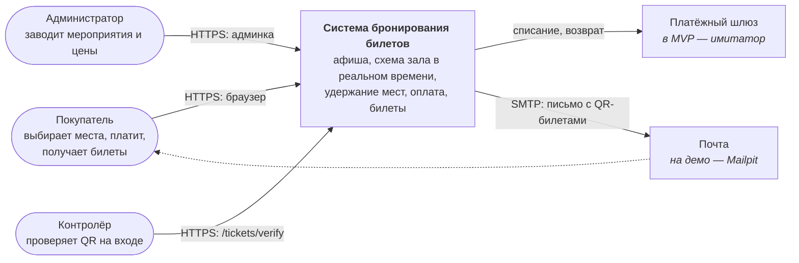
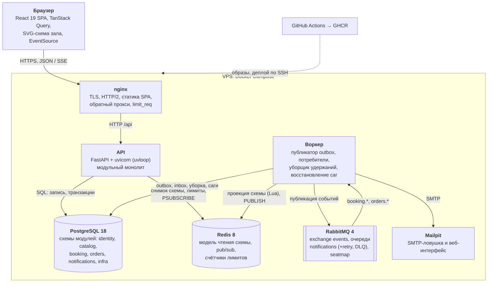
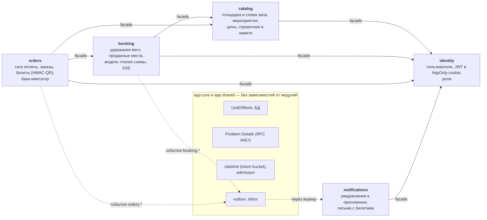
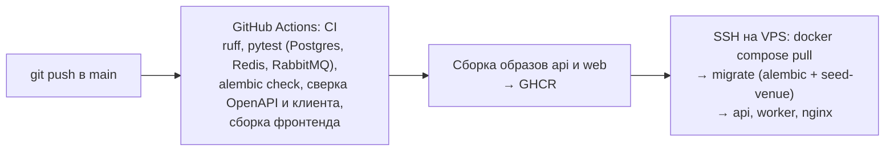

# Архитектура

Система бронирования билетов на мероприятия одной площадки (арена по образцу ВТБ Арены:
хоккей, концерты, шоу). Модульный монолит + фоновый воркер, развёрнут на одном VPS
(https://nevseti.duckdns.org).

Связанные документы:

- [последовательности](sequences.md) — как проходят ключевые сценарии;
- [модель данных](data-model.md) — таблицы и ограничения;
- [ADR](adr/) — архитектурные решения с обоснованием;
- [нагрузочный тест](loadtest-report.md) — проверка гарантий под нагрузкой;
- [сценарий показа](demo-script.md).

## 1. Требования и где они выполнены

| Требование | Реализация |
|---|---|
| Клиент-серверная архитектура | React SPA ↔ REST API (FastAPI) ↔ PostgreSQL; OpenAPI → типизированный клиент (Orval) |
| Модульный монолит + воркер | 5 модулей с границами, проверяемыми тестом (ADR 0001); воркер — тот же образ, другая точка входа (ADR 0006) |
| Защита от двойной продажи | Удержания в PostgreSQL: частичный уникальный индекс + один INSERT; покупка — одна транзакция; ещё два уникальных ключа (§ 4) |
| Схема зала | SVG, 8032 места в двух режимах зала (ADR 0004) |
| Реальное время, обоснование | CQRS-модель чтения в Redis + SSE; почему не WebSocket и не опрос — ADR 0007 |
| Оплата | Сага с компенсацией и восстановлением, банк-имитатор, идемпотентность (ADR 0005) |
| Уведомления, письма, уборка удержаний | Outbox → RabbitMQ → воркер, inbox-идемпотентность, retry и DLQ (ADR 0006) |
| Кэш и ограничение частоты | Redis: модель чтения схемы, token bucket на Lua; nginx `limit_req` (ADR 0008), admission control (ADR 0009) |
| Развёртывание | Docker Compose, nginx + Let's Encrypt, GitHub Actions → GHCR → SSH-деплой (ADR 0002, [deploy.md](deploy.md)) |
| Нагрузочное тестирование | k6: «старт продаж» + проверка 10 инвариантов + эксперимент Redis против PostgreSQL |

## 2. Контекст системы (C4, уровень 1)

## 3. Контейнеры (C4, уровень 2)

API и воркер — **один образ** с разными командами. API ничего не публикует в брокер сам:
события пишутся в outbox той же транзакцией, что и данные, а в RabbitMQ их переносит
воркер. Поэтому событие не теряется и не появляется «лишним» (ADR 0006).

## 4. Компоненты API (C4, уровень 3)

Правила границ (проверяет `tests/architecture/test_module_boundaries.py`, AST-разбор импортов):

1. Из чужого модуля можно импортировать только его `facade` (синхронный вызов) и `events`.
2. Фасады вызываются только по разрешённому направлению: identity ← catalog ← booking ←
   orders; notifications → identity. Циклов нет.
3. Ядро (`app.core`, `app.shared`) не зависит от модулей.
4. У каждого модуля своя схема PostgreSQL; внешних ключей между схемами нет. Связи между
   модулями — логические (по id) и через события.

Устройство модуля: `api.py` (контроллер) → `service.py` (бизнес-правила) →
`repository.py` (SQL) → `models.py`, `schemas.py` (DTO), `facade.py` (публичный интерфейс).

## 5. Паттерны

| Паттерн | Где | Зачем |
|---|---|---|
| **MVC** | Controller — роутеры FastAPI (`modules/*/api.py`); Model — сервисы, репозитории и модели (`service.py`, `repository.py`, `models.py`); View — React-компоненты SPA, данные к ним — DTO `schemas.py` | Разделение HTTP, бизнес-логики и представления |
| **Repository** | `HoldRepository`, `EventRepository`, `VenueRepository`, `UserRepository` | SQL в одном месте; сервис не знает про таблицы |
| **Unit of Work** | `app/core/db.py` — одна сессия и одна транзакция, фиксация только явно | Ответ клиенту уходит после успешного COMMIT |
| **CQRS** | Запись мест — PostgreSQL; чтение схемы — модель чтения в Redis (`booking/seatmap_view.py`), обновляемая воркером по событиям | Самый частый запрос не нагружает БД: 160 запр/с против < 40 (нагрузочный тест) |
| **Saga (оркестрация)** | `orders/saga.py`: STARTED → PAID → COMPLETED / FAILED; компенсации: освободить места, вернуть деньги; восстановление зависших | Оплата — внешний вызов, его нельзя держать внутри транзакции БД |
| **Transactional Outbox + Inbox** | `shared/outbox.py`, `shared/inbox.py`, публикатор в воркере | Доставка «хотя бы один раз» без двойной записи; повтор не шлёт второе письмо |
| **Facade** | `modules/*/facade.py` | Явный публичный интерфейс модуля, границы проверяются тестом |
| **Event-Carried State Transfer** | `orders.order_paid` несёт всё для письма | Уведомлениям не нужно синхронно ходить в заказы |
| **Idempotency Key** | `POST /checkout` с `Idempotency-Key` | Повтор запроса не спишет деньги дважды |
| **Token bucket, admission control** | `core/ratelimit.py`, `core/admission.py` | Защита от злоупотреблений и управляемая деградация под перегрузкой |

## 6. Защита от двойной продажи

1. **Удержание — один оператор.** `INSERT … SELECT … WHERE NOT EXISTS (sold) ON CONFLICT
   DO NOTHING RETURNING` по частичному уникальному индексу `ux_holds_active_seat
   (event_id, seat_id) WHERE status = 'active'`. Из 50 одновременных попыток взять одно
   место выигрывает ровно одна (тест). После вставки продажа перепроверяется отдельным
   оператором: это закрывает гонку READ COMMITTED с ещё не зафиксированной покупкой,
   найденную нагрузочным тестом.
2. **Покупка — одна транзакция.** Погасить удержания, вставить проданные места, создать
   заказ и билеты, записать событие. Удержание к этому моменту должно быть ещё активным и
   своим, иначе откат.
3. **Ещё два рубежа:** первичный ключ `sold_seats (event_id, seat_id)` и уникальный ключ
   `tickets (event_id, seat_id)`. Если бы первый рубеж пропустил гонку, покупка упала бы на
   ключе и сага вернула бы деньги.

Стоячие зоны (Фан-зона на 500, Танцпол на 1500) — это наборы безымянных мест. Билет в зону
занимает любое свободное место зоны, поэтому защита та же и «горячий» счётчик остатка не
нужен (90 покупателей по 6 билетов в зону на 500 мест — продано не больше 500, тест).

## 7. Реальное время

Изменение мест → событие в outbox → воркер (очередь `seatmap`, строго по порядку) →
Lua-скрипт в Redis меняет проекцию, увеличивает версию и публикует изменение → каждый
процесс API держит одну подписку и рассылает изменения своим SSE-зрителям → браузер
применяет изменение с версией N + 1 к снимку N, при пропуске перечитывает снимок.
Задержка ~0,3–0,5 с; при обрыве потока — опрос раз в 5 с. Обоснование выбора SSE —
[ADR 0007](adr/0007-seatmap-read-model-sse.md).

## 8. Развёртывание

На сервере один процесс uvicorn: на 1 vCPU второй почти ничего не даёт. Лимиты памяти
заданы каждому контейнеру. Секреты генерируются на сервере и в репозиторий не попадают.
Подробно — [deploy.md](deploy.md).
