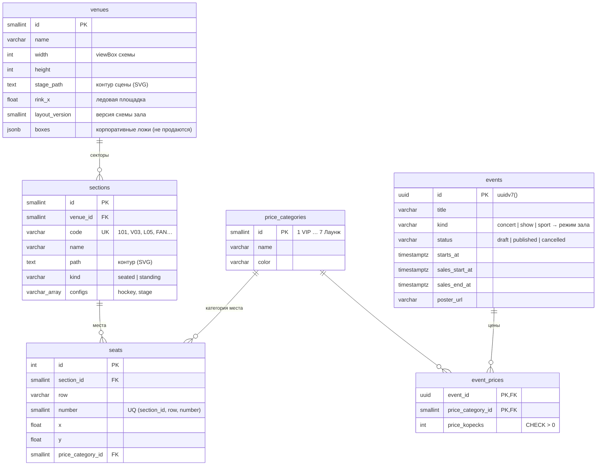
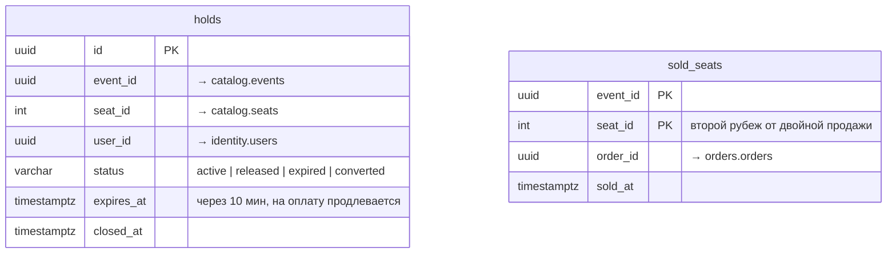
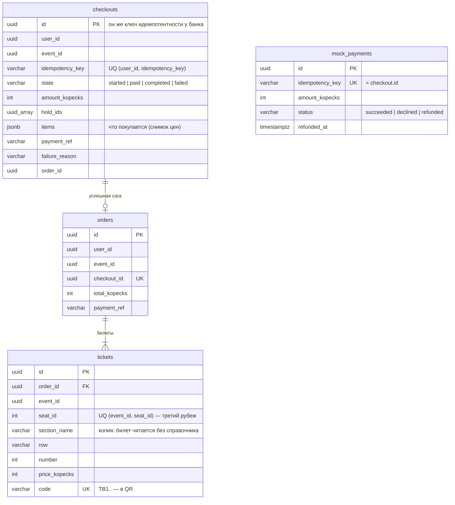
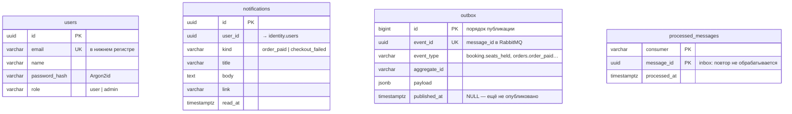

# Модель данных

PostgreSQL 18, у каждого модуля своя схема. Внешние ключи — **только внутри модуля**: связи
между модулями логические (по id) и через события. Так модули можно было бы разнести по
разным БД без переписывания (ADR 0001). Миграции — Alembic, `backend/migrations/`.

## Схема зала и мероприятия (catalog)

Схема зала — справочные данные: генерируется кодом (`catalog/venue_layout.py`), засевается
`seed-venue` и кэшируется в памяти процесса. Стоячая зона хранится как набор безымянных мест
(`row = ''`): билет в зону занимает одно из них.

## Бронирование (booking)

| Индекс / ключ | Назначение |
|---|---|
| `ux_holds_active_seat (event_id, seat_id) WHERE status = 'active'` UNIQUE | **Главная защита:** одно активное удержание на место |
| `ix_holds_active_user (user_id, event_id) WHERE active` | Лимит 6 мест на пользователя |
| `ix_holds_active_expires (expires_at) WHERE active` | Уборщик просроченных удержаний |
| PK `sold_seats (event_id, seat_id)` | Место продаётся один раз |

Истечение ленивое: `now()` нельзя использовать в предикате индекса, поэтому просроченное
удержание остаётся «active», пока его не погасят. Это делает захват этого же места или
уборщик в воркере раз в 15 с (`FOR UPDATE SKIP LOCKED`).

## Заказы и оплата (orders)

Билет хранит сектор, ряд, номер и цену текстом, поэтому он остаётся читаемым и после
перестройки схемы зала.

## Пользователи, уведомления, инфраструктура

`identity.users`, `notifications.notifications`, `infra.outbox` и
`infra.processed_messages` лежат в разных схемах. Outbox и inbox — общая инфраструктура
(`app/shared`), ими пользуются все модули.

## Модель чтения в Redis (не таблица, а проекция)

| Ключ | Содержимое |
|---|---|
| `seatmap:v{версия схемы}:{event_id}` (HASH) | `v` — версия; `s{место}` — h/s у сидячих мест; `p{место}` — у мест стоячих зон; `z{зона}` — занято в зоне |
| канал `seatmap-live:{event_id}` | изменения `{v, seats, zones}` для SSE |
| `rl:{правило}:{субъект}` (HASH) | ведро token bucket: жетоны и время |

Всё в Redis можно пересобрать из PostgreSQL. Поэтому Redis работает с
`maxmemory-policy allkeys-lru` и при нехватке памяти вытесняет ключи, а не отказывает в
записи.
