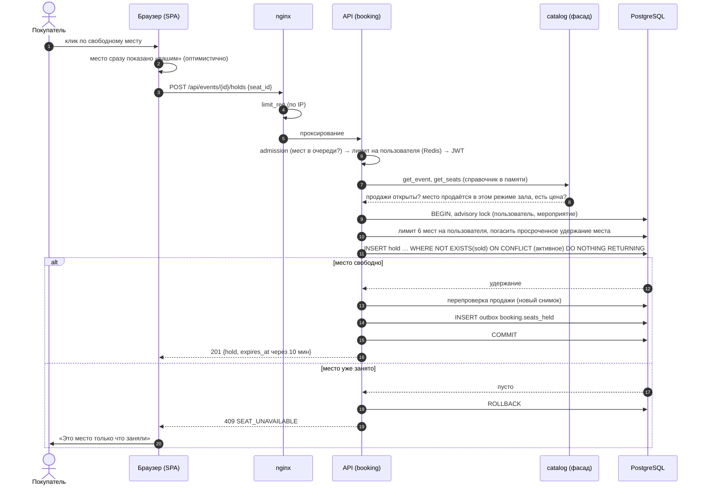
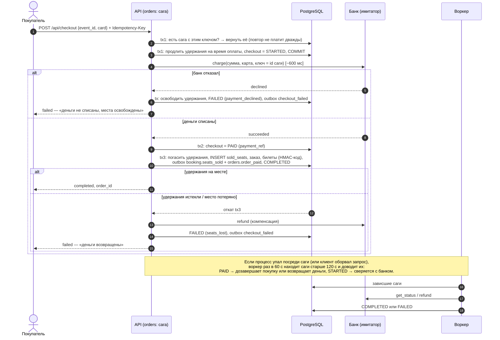
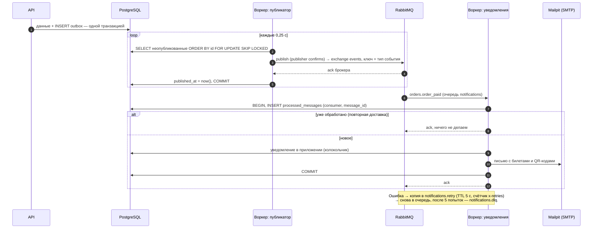
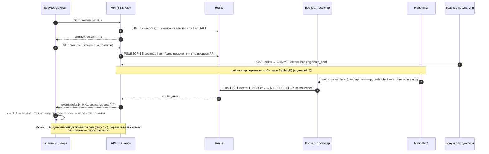
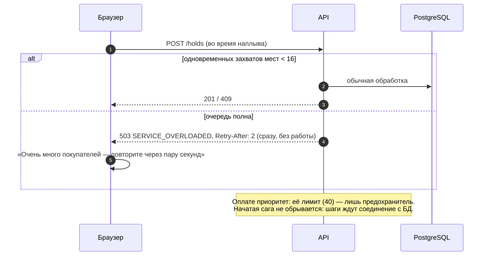

# Диаграммы последовательностей

Ключевые сценарии системы. Архитектура в целом — [architecture.md](architecture.md).

## 1. Удержание места

Клик по месту на схеме. Защита от двойной продажи — в одном операторе INSERT.

## 2. Оплата: сага с компенсацией

Оплата — внешний вызов, поэтому каждый шаг саги — своя короткая транзакция, а банк
вызывается вне транзакции.

## 3. События: outbox → RabbitMQ → уведомления

## 4. Схема зала в реальном времени (CQRS + SSE)

## 5. Перегрузка: сброс нагрузки на входе

